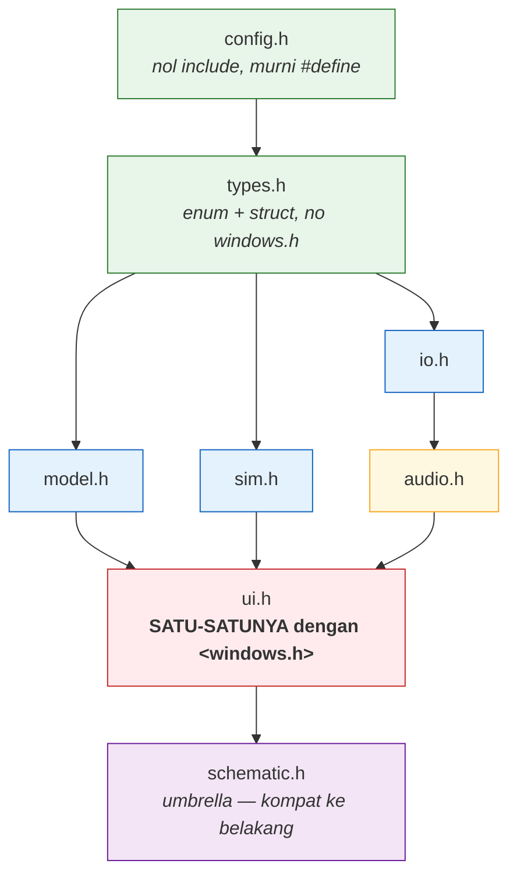
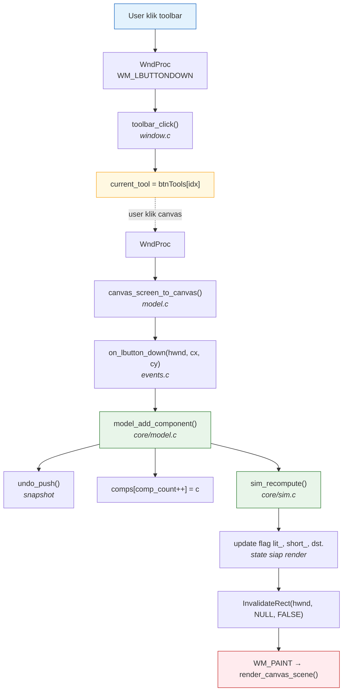

# ARCHITECTURE — Schematic Editor

Dokumen ini menjelaskan **struktur internal**, **kontrak dependency antar
modul**, dan **alasan desain** di balik pemisahan layer. Untuk cara
menambah fitur, lihat [`CONTRIBUTING.md`](CONTRIBUTING.md).

---

## 1. Prinsip dasar

Proyek ini dibangun dengan **satu aturan utama**:

> **Logika bisnis (core) tidak boleh bergantung pada Win32. UI boleh
> bergantung pada core. Core tidak boleh bergantung pada UI.**

Semua keputusan desain lain mengalir dari aturan ini. Konsekuensinya:

| Layer | Boleh `#include <windows.h>`? | Bisa di-unit-test di Linux? |
|---|---|---|
| `core/` (model, sim) | ❌ **Tidak** | ✅ Ya |
| `io/` (JSON, PNG encoder) | ❌ **Tidak** | ✅ Ya |
| `audio/` (buzzer) | ✅ Ya (impl detail) | ❌ Diganti stub |
| `ui/` (semua rendering + event) | ✅ **Hanya di sini** | ❌ Tidak |

Manfaat konkret:
- Bug di logika fisika (`sim.c`) atau serialisasi JSON (`fileio.c`) bisa
  ditangkap di CI Linux tanpa toolchain MinGW.
- Refactor UI tidak berisiko merusak simulasi.
- Test suite berjalan dalam <1 detik tanpa GDI/audio device.

---

## 2. Dependency graph

Arah panah = "include" (consumer → dependency).




### Aturan include per layer

| File | Boleh include |
|---|---|
| `include/config.h` | **Hanya** `#define`. Nol `#include`. |
| `include/types.h` | `config.h` saja. |
| `include/model.h` | `types.h` (transitif: `config.h`). |
| `include/sim.h` | `types.h`. |
| `include/io.h` | `<stddef.h>`, `types.h`. |
| `include/audio.h` | `types.h`. |
| `include/ui.h` | `<windows.h>`, `<math.h>`, `<stdio.h>`, `<string.h>`, `<wchar.h>`, `model.h`, `sim.h`. |
| `src/core/*.c` | `model.h` / `sim.h` + `<math.h>`, `<stdarg.h>`, `<stdio.h>`, `<stdlib.h>`, `<wchar.h>`. |
| `src/io/fileio.c`, `png_writer.c` | `io.h` + CRT headers. |
| `src/io/export_png.c` | `ui.h`, `io.h` + CRT. |
| `src/audio/buzzer_audio.c` | `audio.h`, `model.h`, `sim.h`, `<windows.h>`, `<mmsystem.h>`. |
| `src/ui/**` | `ui.h` (yang sudah membawa `<windows.h>`). |
| `src/components/**` | `ui.h`. |
| `src/main.c` | `ui.h`. |
| `tests/**` | `test_support.h`, `model.h`, `sim.h`, `audio.h`. **Tidak boleh** `ui.h`. |

**Jangan pernah** include `<windows.h>` di file core/io/audio **header**.
Kalau butuh `HWND` di header API, itu tanda fungsi harus dipindah ke
`ui.h`.

---

## 3. Alur data

### A. Edit (mode normal)




### B. Render (WM_PAINT)

```sh
[WM_PAINT di window.c]
│
├→ [draw_toolbar(memDC, W)] ← ui/toolbar/palette.c
│ └→ draw_menubar
│ └→ draw_one_tool_button × N
│ └→ toolbar_draw_symbol
│ └→ draw_toolbar_scrollbar
│
├→ [SetViewportOrgEx(0, TOOLBAR_H)]
│
├→ [render_canvas_scene(memDC, W, canvas_h, 1)] ← ui/canvas/draw.c
│ │
│ ├→ grid (screen coords, sebelum world transform)
│ │
│ ├→ SetWorldTransform(zoom + pan)
│ │
│ ├→ draw_wires()
│ │ └→ for each wire: stroke_ortho + endpoint dot
│ │ └→ junction dots
│ │ └→ preview wiring (kalau aktif)
│ │
│ ├→ for each component: draw_component()
│ │ └→ draw_k_<type>() ← components/*.c
│ │ └→ with_rotation(fn)
│ │ └→ draw_value_label (kecuali minimap_mode)
│ │ └→ outline seleksi (kalau selected)
│ │ └→ draw_pins (kalau wiring / selected)
│ │
│ ├→ RestoreDC (kembali ke screen coords)
│ │
│ ├→ draw_selection_overlay() (kalau include_ui_overlay)
│ ├→ draw_marquee_overlay() (kalau include_ui_overlay)
│ ├→ banner simulasi (kalau sim_running)
│ ├→ draw_short_marker (kalau RUN & short)
│ └→ minimap_render (kalau include_ui_overlay)
│
└→ status bar (kalau g_show_status)

text
```


### C. Simulasi (RUN)
---

```sh
[sim_set_running(1)]
│
├→ guard: comp_count == 0 → tolak + set_status
│
├→ sim_running = 1
│
└→ sim_recompute() ← core/sim.c
│
├─(1) build_unions()
│ ├→ union kabel
│ ├→ saklar ON
│ ├→ induktor DC
│ ├→ dioda forward
│ ├→ transistor/MOSFET ON
│ └→ gate outputs (iterative)
│
├─(2) gate_state_ stabilization (max 8 iterasi)
│
├─(3) short detection (+)-(–)
│ ├→ komponen konduktif (culprit)
│ ├→ wire victim (midpoint)
│ └→ fallback: pin (+) sumber
│
├─(4) na_build_nodes() ← union-find root → index matrix
│
├─(5) na_assign_fixed_mode() ← V source anchors
│
├─(6) na_build() + na_solve() ← Gauss elimination
│ └→ hasil: Vth_node[] (tegangan open semua node)
│
├─(7) LED: hitung I = (Vth - Vf)/Rth
│ ├→ overcurrent → blown_ / sim_overcur
│ └→ exploded → blown_ / sim_exploded
│
├─(8) Buzzer ON detection
├─(9) Voltmeter/ammeter reading
├─(10) hot-wire flag untuk kabel di net (+)
│
└→ buzzer_audio_update() ← audio/buzzer_audio.c
```


Setelah `sim_recompute()`, flag `lit_[]`, `cond_[]`, `dfwd_[]`, `short_`,
dst. siap dibaca oleh modul UI untuk coloring dan status banner.

---

## 4. Design decisions — "kenapa begini?"

### 4.1 Mengapa `config.h` tidak punya `#include` sama sekali?

Karena `config.h` adalah **akar dependency tree**. Kalau dia include
`<stdio.h>`, maka setiap file yang include `config.h` (langsung atau
tidak langsung) ikut menarik `stdio.h` — padahal sebagian besar file
tidak butuh. Konsekuensi buruknya: unit test link dengan CRT yang tidak
perlu, dan compile time naik tanpa alasan.

**Aturan**: konstanta numerik murni di `config.h`. Nilai string tidak
boleh (`#define NAME L"foo"` harusnya di file yang lebih spesifik).
`typedef` tidak boleh (itu ranah `types.h`).

### 4.2 Mengapa `model.h` tidak mendeklarasikan `edit_value_dialog`?

Karena `edit_value_dialog` butuh `HWND`. Kalau deklarasinya ditaruh di
`model.h`, maka `model.h` butuh `<windows.h>`, dan core jadi tidak pure.

**Solusi**: fungsi-fungsi UI-coupled dipindah ke `ui.h`, meskipun
implementasinya masih sesekali di file yang sama (selama fase transisi).
Saat ini sudah selesai: `edit_value_dialog` di `ui/dialogs/value_editor.c`,
`canvas_zoom_center` di `ui/canvas/viewport.c`.

### 4.3 Mengapa `fileio.c` dipecah jadi `fileio.c` + `file_dialogs.c`?

File `fileio.c` lama mencampur dua hal:
- **Serialisasi murni**: `model_save_json`, `model_load_json`,
  `comp_type_json_name` — hanya butuh `_wfopen` + `fwprintf`.
- **UI interaktif**: `model_save_dialog`, `model_load_dialog`,
  `model_export_png_dialog` — butuh `OPENFILENAMEW`, `MessageBoxW`.

Dengan pemisahan:
- Bagian murni bisa diuji dengan test round-trip JSON di Linux.
- Perubahan UX dialog (misal tambah filter file) tidak menyentuh logika
  serialisasi.
- `io/fileio.c` bisa di-`#include` dari core tanpa menyeret Win32.

### 4.4 Mengapa `png_writer.c` menulis PNG "uncompressed"?

Karena proyek ini tidak ingin dependensi `libpng` / `zlib` / `GDI+` / `WIC`.
PNG dengan **deflate stored blocks** (kompresi nol) tetap **100% valid**
secara spec — hanya lebih besar (file 1100×650 jadi ~3 MB, bukan ~300 KB).
Trade-off: **portabilitas vs ukuran**.

Kalau nanti dibutuhkan kompresi, ganti `png_writer.c` dengan implementasi
yang memakai zlib — signature `png_write_rgb()` tidak perlu berubah.

### 4.5 Mengapa `sim.c` memakai union-find?

Rangkaian elektronika adalah **graf**. Untuk menyelesaikan KCL, kita butuh
tahu **node mana yang secara elektris sama** (terhubung oleh kabel atau
penghantar ideal 0Ω). Union-find dengan path compression memberi
operasi `union` dan `find` dalam O(α(n)) — near-konstan. Alternatifnya
(BFS/DFS per solve) lebih lambat dan lebih rumit.

### 4.6 Mengapa gate logika butuh iterasi stabilisasi?

Rangkaian dengan gate multi-tingkat:

```sh
A ──┐
├── AND ──┐
B ──┘ ├── OR ── OUT
│
C ────────────┘
```

Output OR bergantung pada output AND. Tapi `OR` sudah dihitung sebelum
`AND` selesai. Solusinya: **loop iterasi** — setiap putaran, gate membaca
state union-find terkini dan menghitung output; union-find di-rebuild
dengan gate_state terbaru. Konvergen dalam ≤ (jumlah level gate) iterasi.

Feedback loop (NOT → NOT → ...) akan berosilasi; dibatasi 8 iterasi dan
output akhirnya stabil di satu sisi.

### 4.7 Mengapa ada file `schematic.h` (umbrella) padahal sudah dipecah?

Untuk **kompatibilitas ke belakang** selama migrasi. Setiap file lama yang
masih `#include "schematic.h"` otomatis tetap compile tanpa diubah. Setelah
seluruh migrasi selesai, `schematic.h` boleh dipertahankan (kenyamanan)
atau dihapus total (disiplin header). Keputusan ini sengaja ditunda.

---

## 5. Kontrak test build

| Aspek | Produksi | Test |
|---|---|---|
| Defines | `SCHEMATIC_PRODUCTION=1` | `SCHEMATIC_TEST_STUBS=1` |
| Include | `-Iinclude` | `-Iinclude -include tests/platform_compat.h` |
| Audio | `src/audio/buzzer_audio.c` | `tests/stubs_audio.c` (no-op) |
| Win32 lib | `-lgdi32 -luser32 -lcomdlg32 -lwinmm` | (tidak ada) |
| Entry point | `wWinMain` (`-municode`) | `main` |
| File test-only | tidak ada | `test_reset_model`, `test_reset_sim` |

**Guard**: kalau `SCHEMATIC_TEST_STUBS` terdeteksi di build produksi,
Makefile & CMakeLists.txt langsung `error`. Ini mencegah kontaminasi
silang.

---

## 6. Known limitations & TODO

| Topik | Status | Catatan |
|---|---|---|
| `set_status` di `model.c` memakai `_vsnwprintf` (MSVCRT) | ⚠️ | Bisa diganti `vswprintf` portabel — TODO kecil. |
| `test_wfopen` shim di Linux tidak strip `", ccs=UTF-8"` | ⚠️ | Tidak masalah saat ini (test belum sentuh JSON I/O). Perlu upgrade kalau nanti ada test JSON round-trip. |
| `toolbar_draw_symbol` punya dua blok cabang `TOOL_*` (dead code di cabang kedua) | ⚠️ | Cosmetic. Cleanup di fase audit kode terpisah. |
| `draw_k_resistor` pakai `HPEN oldBrush` (harusnya `HBRUSH`) | ⚠️ | Cosmetic. Dipertahankan sesuai prinsip "migrate not rewrite". |
| `AC_MAINS_FREQ_HZ` belum dipakai `oscilloscope.c` (masih `OSC_FREQ_HZ` sendiri) | ⚠️ | Konsolidasi nanti. |
| Rotasi komponen 90°/270° untuk label voltmeter | ⚠️ | Label bacaan tetap tegak (by design) — mungkin perlu penyesuaian visual di masa depan. |
| Kalau `png_write_rgb` dijalankan di Linux | ❌ | Butuh shim `_wfopen` yang strip `ccs=` — belum diuji. |

---

## 7. Referensi cepat — file mana isinya apa?

| Anda ingin mengubah... | Sentuh file |
|---|---|
| Perilaku simulasi (Vth, Rth, gate) | `src/core/sim.c` |
| Model data / undo / seleksi | `src/core/model.c` |
| Format JSON | `src/io/fileio.c` |
| Ukuran/format PNG | `src/io/png_writer.c` |
| Simbol komponen tertentu | `src/components/<nama>.c` |
| Warna / layout toolbar | `src/ui/toolbar/*.c` |
| Event mouse / keyboard | `src/ui/canvas/events.c` |
| Menu bar / context menu | `src/ui/toolbar/menubar.c` + `src/ui/canvas/events.c` |
| Panel osiloskop | `src/ui/panels/oscilloscope.c` |
| Splash screen | `src/ui/panels/splash.c` |
| Konstanta numerik global | `include/config.h` |
| Tambah tipe komponen | `include/types.h` + `src/core/model.c` + `src/components/<nama>.c` |